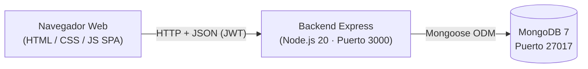
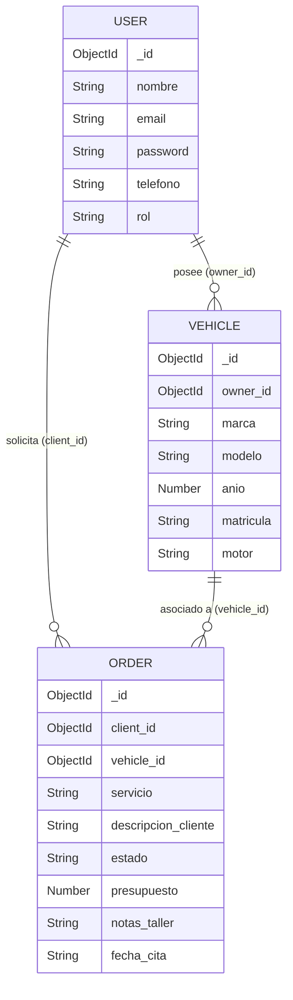
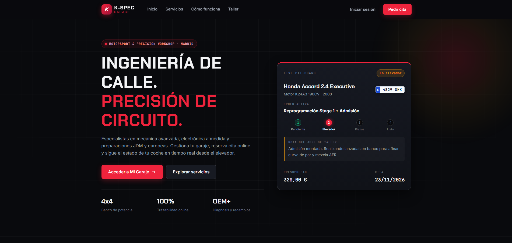
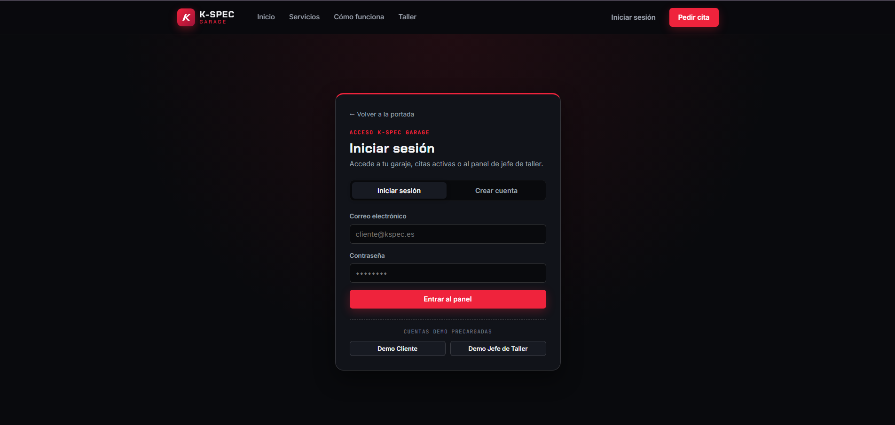
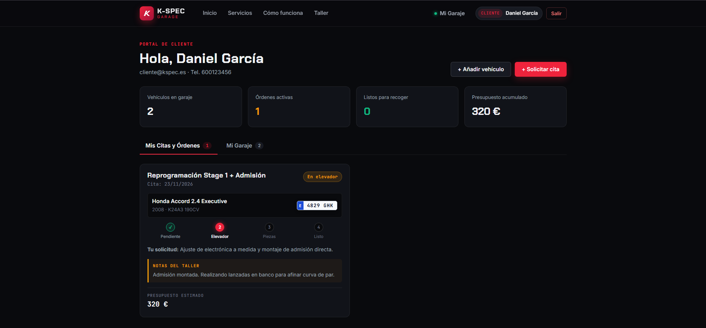
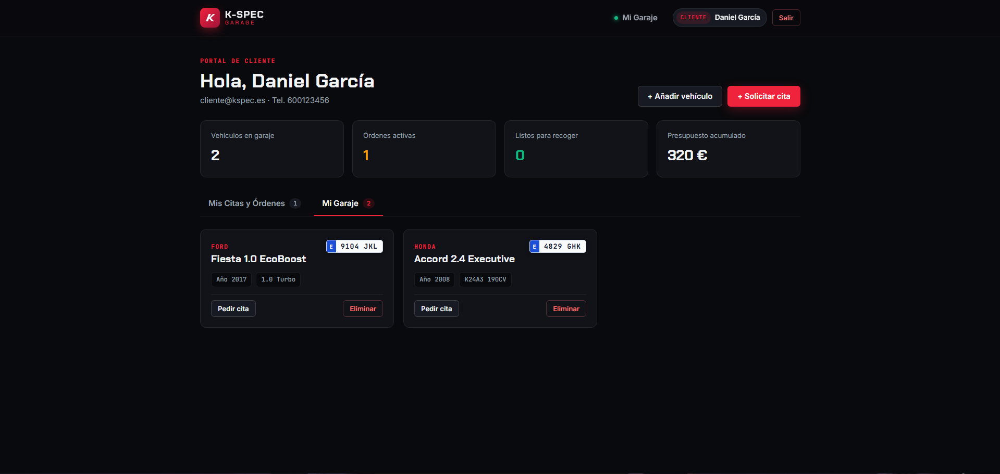
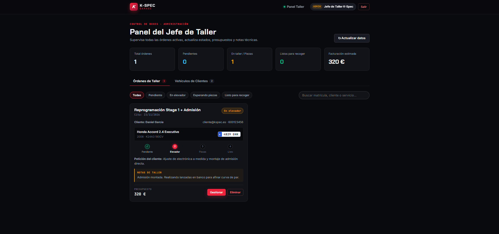
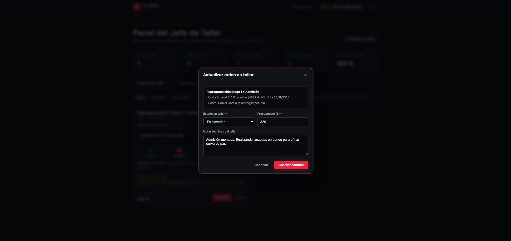

# Memoria del Proyecto — K-Spec Garage

**Módulo:** Proyecto Intermodular (2º DAM)  
**Proyecto:** K-Spec Garage — Aplicación web de gestión de taller mecánico y preparaciones

---

## 1. Introducción y objetivo

En muchos talleres pequeños o especializados en mecánica y preparación de vehículos, el seguimiento de las citas sigue haciéndose por teléfono o WhatsApp. Eso acaba generando llamadas repetidas para preguntar si el coche está listo, presupuestos poco claros y falta de historial organizado por vehículo.

El objetivo de **K-Spec Garage** es ofrecer una aplicación web sencilla y directa que cubra ese flujo completo:

- Dar una presencia web clara del taller con sus servicios.
- Permitir que cada cliente tenga su propio garaje digital y pida cita en pocos pasos.
- Mostrar en tiempo real en qué punto está cada reparación o preparación (`Pendiente`, `En elevador`, `Esperando piezas` o `Listo para recoger`) junto con las notas del mecánico y el presupuesto.
- Facilitar al jefe de taller un panel centralizado para controlar todas las órdenes sin tener que cambiar de herramienta.

---

## 2. Alcance y requisitos funcionales

La aplicación distingue tres niveles de acceso:

### Usuario no autenticado (visitante)
- Consultar la portada del taller, el listado de servicios orientativos y cómo funciona el proceso.
- Comprobar el estado del servicio mediante el indicador de conexión con la API.
- Registrarse como cliente o iniciar sesión.

### Cliente (`rol: "cliente"`)
- Iniciar sesión y mantener la sesión activa entre recargas (token JWT guardado en `localStorage` y validado con `/api/auth/me`).
- Dar de alta vehículos indicando marca, modelo, año, matrícula y motor.
- Consultar y eliminar vehículos de su garaje.
- Solicitar nuevas citas eligiendo uno de sus vehículos, un servicio predefinido o personalizado, fecha y observaciones.
- Consultar sus órdenes activas, su barra de progreso por fases, el presupuesto asignado y las notas técnicas del taller.

### Jefe de taller (`rol: "admin"`)
- Ver un resumen global del taller (total de órdenes, pendientes, en trabajo/piezas, listas para recoger y facturación estimada).
- Filtrar órdenes por estado y buscar por matrícula, cliente, servicio o descripción.
- Actualizar el estado de una orden, fijar o modificar el presupuesto y redactar notas técnicas visibles para el cliente.
- Eliminar órdenes o vehículos cuando sea necesario.
- Consultar el listado de vehículos de todos los clientes junto con los datos de contacto del propietario.

---

## 3. Arquitectura y tecnologías

Se ha optado por una arquitectura cliente-servidor empaquetada con Docker Compose para que pueda levantarse en cualquier equipo con un único comando y sin depender de configuraciones manuales.



### Decisiones técnicas

- **Node.js + Express (`backend/`):** permite construir la API REST de forma rápida y clara y, a la vez, servir los archivos estáticos del frontend desde el mismo origen (`/`) sin complicaciones de despliegue ni problemas de CORS en producción.
- **MongoDB + Mongoose:** encaja bien con el modelo de documentos de usuarios, vehículos y órdenes, y simplifica las referencias entre colecciones mediante `populate()` y las validaciones de esquema (como el `enum` de estados de una orden).
- **JWT + bcryptjs:** las contraseñas nunca se guardan en texto plano (se cifran con salt de 10 rondas) y las rutas privadas se protegen con `authMiddleware` y `adminMiddleware`.
- **Frontend en HTML, CSS y JavaScript puro:** se ha implementado como una SPA ligera sin frameworks pesados ni paso de compilación, manteniendo el código fácil de leer y desplegar directamente mediante volumen en Docker (`./frontend:/app/frontend`).
- **Docker Compose:** levanta el servicio `backend` (imagen `node:20-alpine`) y el servicio `mongo` (imagen `mongo:7` con volumen persistente `mongo_data`). Además, `server.js` incluye reintentos de conexión (`connectWithRetry`) para esperar a que MongoDB termine de arrancar.

---

## 4. Modelo de datos

La base de datos `kspec_garage` cuenta con tres colecciones principales gestionadas con Mongoose:



### Detalle de colecciones

1. **`User` (`backend/models/User.js`)**
   - `email` único, normalizado en minúsculas.
   - `rol` restringido a `['cliente', 'admin']`, por defecto `'cliente'`.
   - `timestamps: true` para registrar creación y actualización.

2. **`Vehicle` (`backend/models/Vehicle.js`)**
   - Vinculado al propietario mediante `owner_id` (`ref: 'User'`).
   - `matricula` normalizada automáticamente a mayúsculas (`uppercase: true`).

3. **`Order` (`backend/models/Order.js`)**
   - Vinculada a `client_id` (`ref: 'User'`) y `vehicle_id` (`ref: 'Vehicle'`).
   - `estado` restringido a: `Pendiente`, `En elevador`, `Esperando piezas` y `Listo para recoger`.
   - `presupuesto` numérico (por defecto `0`) y `notas_taller` con mensaje inicial automático.

---

## 5. Documentación de la API REST

Todas las rutas privadas requieren la cabecera:

```http
Authorization: Bearer <token_jwt>
```

### Autenticación (`/api/auth`)

- **`POST /api/auth/register`**  
  Crea una cuenta de cliente. Valida campos obligatorios, correo no duplicado y contraseña de al menos 6 caracteres. Devuelve `{ token, user }`.
- **`POST /api/auth/login`**  
  Comprueba credenciales con `bcrypt.compare` y devuelve `{ token, user }` (expiración de 7 días).
- **`GET /api/auth/me`** *(requiere token)*  
  Devuelve el perfil del usuario autenticado (sin contraseña) para restaurar la sesión en el frontend.

### Vehículos (`/api/vehicles`)

- **`GET /api/vehicles`** *(requiere token)*  
  Si el rol es `cliente`, devuelve únicamente sus vehículos. Si es `admin`, devuelve todos los vehículos del taller con los datos del propietario (`owner_id`).
- **`POST /api/vehicles`** *(requiere token)*  
  Registra un vehículo asignado automáticamente al usuario del token (`req.user.id`).
- **`DELETE /api/vehicles/:id`** *(requiere token)*  
  Un cliente solo puede borrar sus propios vehículos; un `admin` puede eliminar cualquiera.

### Órdenes (`/api/orders`)

- **`GET /api/orders`** *(requiere token)*  
  Devuelve las órdenes del cliente (o todas si es `admin`), ordenadas de más reciente a más antigua y con `client_id` y `vehicle_id` populados.
- **`POST /api/orders`** *(requiere token)*  
  Crea una nueva orden comprobando previamente que el `vehicle_id` pertenece al cliente autenticado.
- **`PUT /api/orders/:id`** *(requiere token + rol `admin`)*  
  Actualiza `estado`, `presupuesto` y `notas_taller` aplicando las validaciones del modelo (`runValidators: true`).
- **`DELETE /api/orders/:id`** *(requiere token + rol `admin`)*  
  Elimina la orden indicada.

### Estado del servidor

- **`GET /api/health`**  
  Devuelve `{ "status": "ok", "service": "K-Spec Garage API" }`.

---

## 6. Instalación y despliegue

### Requisitos previos
- Docker Desktop (o Docker Engine + Docker Compose) instalado y en ejecución.

### Puesta en marcha
1. Clonar o descargar el repositorio y situarse en la carpeta raíz `k-spec-garage`.
2. Ejecutar:
   ```bash
   docker compose up --build
   ```
3. Esperar a ver en consola la confirmación de conexión a MongoDB y arranque del servidor en el puerto `3000`.
4. Abrir el navegador en `http://localhost:3000`.

### Datos iniciales (seed)
La primera vez que arranca el servidor con la base de datos vacía, `seedDatabase()` inserta:
- Usuario administrador: `admin@kspec.es` / `admin123`
- Usuario cliente: `cliente@kspec.es` / `cliente123`
- Dos vehículos asociados al cliente (`Honda Accord 2.4 Executive` y `Ford Fiesta 1.0 EcoBoost`)
- Una orden inicial en estado `En elevador` para probar el flujo desde el primer minuto.

---

## 7. Manual de uso y capturas

### 7.1. Portada pública
Al entrar en `http://localhost:3000` se muestra la portada de K-Spec Garage con el resumen de servicios, una vista previa del tablero de seguimiento, los pasos para pedir cita y el estado de la API en el pie de página.



### 7.2. Registro e inicio de sesión
Desde los botones **Iniciar sesión** o **Pedir cita** se accede a la pantalla de autenticación. Se puede crear una cuenta nueva o entrar directamente con cualquiera de las dos cuentas de prueba.



### 7.3. Portal del cliente (Mi Garaje y Mis Citas)
Una vez dentro como cliente, se muestran los contadores principales y dos pestañas:
- **Mis Citas y Órdenes:** muestra cada cita con su matrícula, barra de 4 pasos, notas del mecánico y presupuesto estimado.
- **Mi Garaje:** permite consultar los vehículos dados de alta, añadir nuevos coches o pedir cita directamente sobre uno de ellos.





### 7.4. Panel del jefe de taller (Admin)
Al acceder con la cuenta de administrador se abre el panel de control con los totales del taller, filtros por estado, buscador y el botón **Gestionar** en cada tarjeta para actualizar el estado, el presupuesto y las notas técnicas.





---

## 8. Seguridad y buenas prácticas aplicadas

- Cifrado de contraseñas con `bcryptjs` antes de guardar en MongoDB.
- Protección de rutas en backend mediante verificación de firma JWT y comprobación de rol (`adminMiddleware`) para operaciones sensibles.
- Validación de propiedad de los recursos en el servidor (un cliente no puede crear citas ni borrar vehículos que no pertenezcan a su `owner_id`).
- Escapado de cadenas (`escapeHtml`) en el renderizado del frontend para evitar inyección de HTML/XSS en campos introducidos por los usuarios.
- Persistencia de datos de MongoDB mediante volumen Docker (`mongo_data`) y reconexión automática al inicio.

---

## 9. Posibles mejoras futuras

Como continuación del proyecto en futuras versiones se podrían incorporar:
- Notificaciones por correo electrónico cuando una orden cambie a `Listo para recoger`.
- Subida de fotografías del proceso en el elevador adjuntas a cada orden.
- Exportación de presupuestos o resúmenes de orden en formato PDF.
- Calendario con control de franjas horarias disponibles por elevador para evitar solapamientos.
